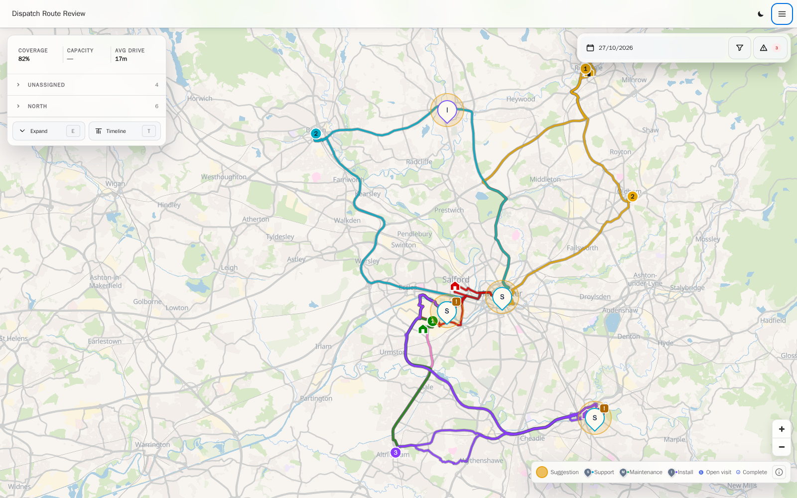
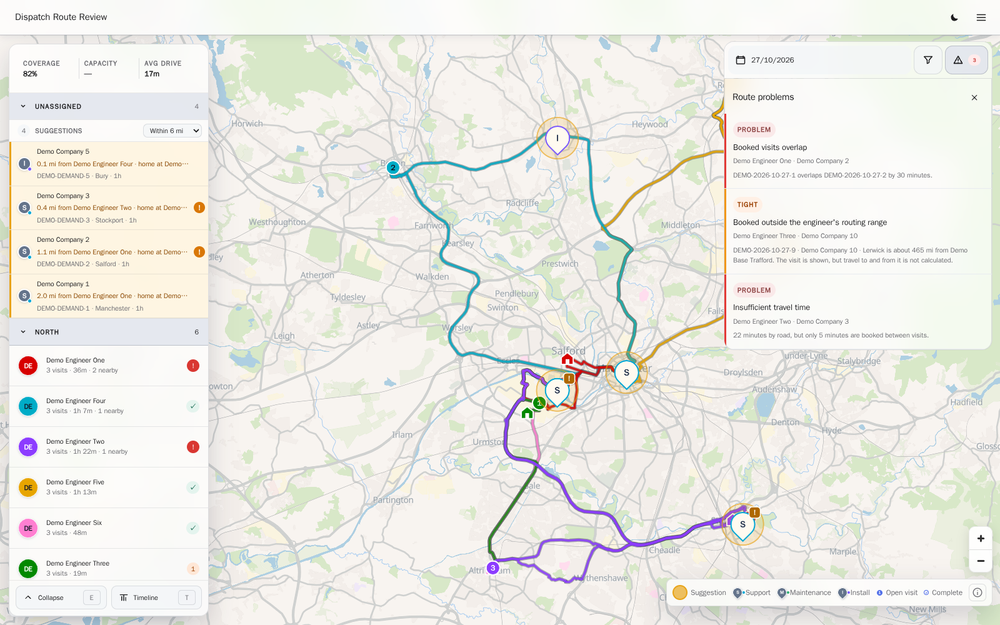

# Dispatch Route Review

A read-only map of booked field-engineer visits from Autotask, with nearby
unassigned work.

Purpose built for a logistics team to see which jobs sit close to where
engineers already are, and book them into efficient routes.

## Features

- Shows each engineer's day as a road route from their home base.
- Suggests unassigned work near an engineer's next stop or home base, within
  their working hours.
- Flags overlapping bookings, travel gaps shorter than the road estimate,
  stops over 700 km from base and sites with no usable location.
- Signs users in with Microsoft Entra. Roles, page permissions and an audit
  log live in PostgreSQL.
- Runs as a demo with fictional data and no login.

## Stack

Next.js 16, React 19, MapLibre, PostgreSQL 16 and OSRM, run with Docker
Compose.

## How it works

- A cache worker is the only process that talks to Autotask. The web app reads
  PostgreSQL snapshots, so it can't change an Autotask record. Lint fails the
  build if web code imports Autotask code.
- Every snapshot carries its age. The UI warns on stale data, and the API
  returns an error for expired data instead of an empty list. A failed load
  never looks like a quiet day.
- Road routing runs on the server. Each request has an OSRM call cap, a
  deadline and a circuit breaker.
- The worker geocodes UK postcodes and European addresses. It sends only
  location fields, and the cache stores hashed keys instead of addresses.
- Queues and statuses match by numeric Autotask ID, because labels get renamed.
- The code is a modular monolith. A lint script enforces module boundaries and
  dependency direction.
- I patched a MapLibre 5.24 tile cache gap that made the basemap vanish during
  long map flights.

## Running it

One Docker Compose command starts the demo. See [setup](docs/SETUP.md) for
that, connecting real Autotask data and running the tests.

## Licence

[MIT](LICENSE).
